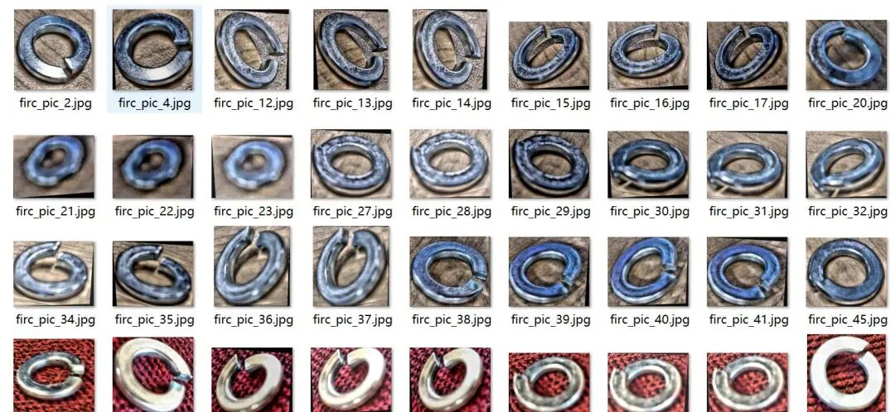
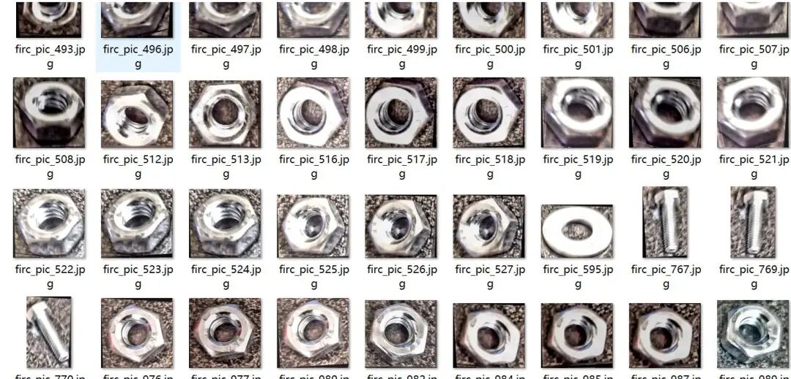
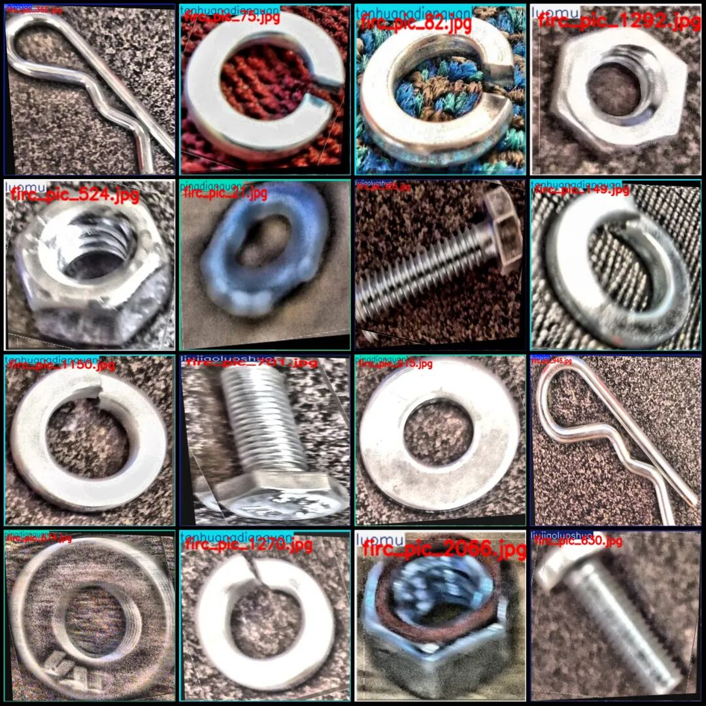
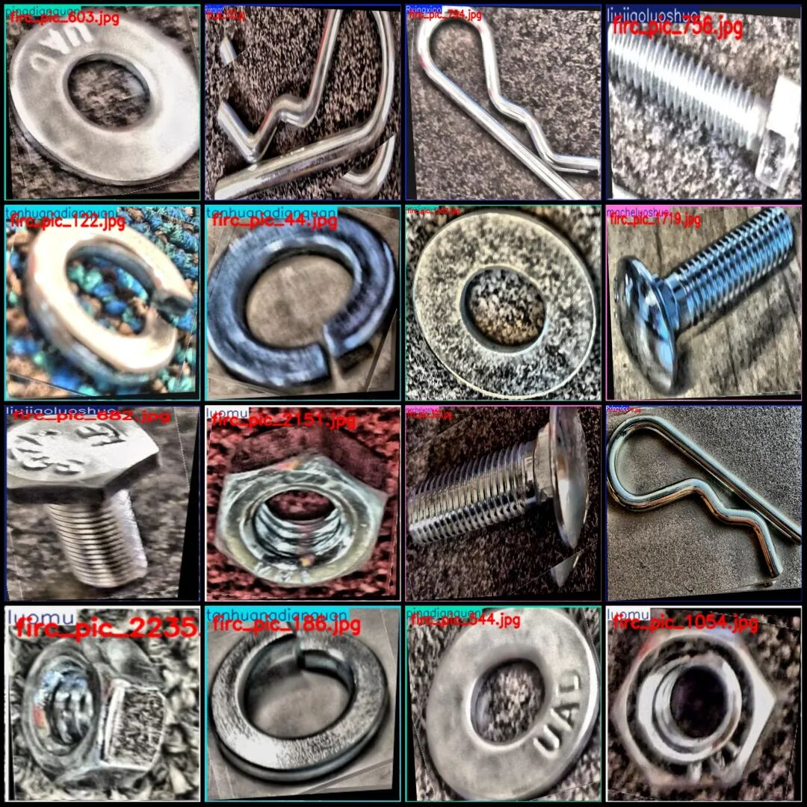

# Industrial Fasteners and Bolts Detection Dataset VOC+YOLO format with 2357 images in 6 categories

Dataset format: Pascal VOC format + YOLO format (txt file without split path, only containing jpg images and corresponding VOC format xml files and yolo format txt files)

Number of images (number of jpg files): 2357

Number of annotations (number of xml files): 2357

Number of annotations (number of txt files): 2357

Label count: 6

Label category names (Note that the order of categories in the YOLO format does not correspond to this, but is based on the classes.txt file in the labels folder): ["Rxingxiao", "liujiaoluoshuo", "luomu", "macheluoshuo", "pingdianquan", "tanhuangdianquan"]

Number of boxes labeled for each category: ["R-shaped pin", "Hex bolt", "Nuts", "Pony bolt", "Flat washers", "Spring washers"]

Rxingxiao Frame Count = 430

Liujiaoluoshuo Frames = 448

Number of luomu = 485

macheluoshuo frame count = 245

Pingdianquan Frame Count = 308

tanhuangdianquan frame count = 441

Total frame count: 2357

Number of images per category:

Rxingxiao occupies the number of images = 430

Liujiaoluoshuo occupies a total of 448 images.

Luomu's number of images = 485

Macheluoshuo occupies the number of images = 245

Pingdianquan's possession of images = 308

tanhuangdianquan occupies = 441

Image resolution: Multi-resolution images, such as 394x389, 484x671, etc.

Using labelImg:

Annotation rules: Draw a rectangle around the category.

Important Notice: The dataset does not have separate training, validation, and test sets; you need to partition them yourself.

Special : This dataset does not guarantee the accuracy of the trained models or weight files.

Image Preview:

Annotation example:

## Payment

Here is a pay link on Stripe ( https://buy.stripe.com/3cs8yP7sY87d0vu9AB ). Please contact me lonlonago@foxmail.com after funding $89, and I will send you a complete data files , thank you!

